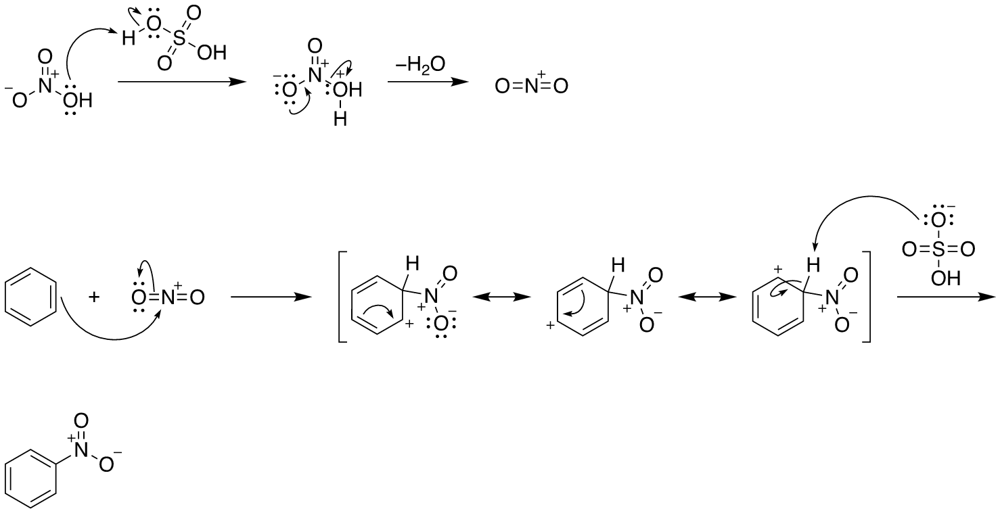
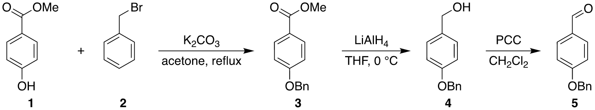
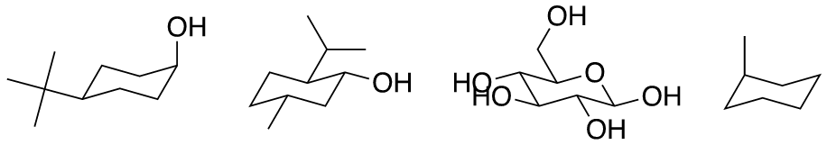
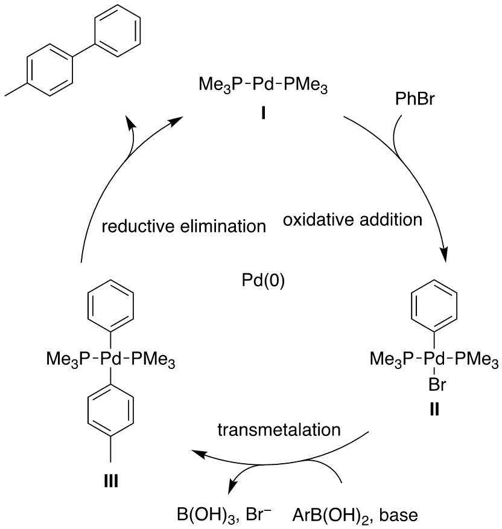

# acs-chem-svg

A [Claude Code](https://code.claude.com) skill that draws chemical structures, reaction
schemes, arrow-pushing mechanisms, and catalytic cycles in ACS style (ChemDraw's *ACS Document
1996*) as editable **SVG**, with a **CDXML** copy to open in ChemDraw.

Ask in plain language:

> Draw the full arrow-pushing mechanism for the nitration of benzene with HNO3 and H2SO4:
> formation of the nitronium ion, attack by benzene, the resonance structures of the sigma
> complex, and deprotonation to nitrobenzene.

and Claude writes a short YAML spec, validates the chemistry and the electron bookkeeping,
renders it, looks at the rendered image, fixes what it sees, and hands back `.svg`, `.cdxml`,
`.yaml` and `.png` files:





## What it draws

- **Structures** from SMILES: rings, double and triple bonds, wedges and hashes, heteroatom
  labels with H counts and charges.
- **Abbreviations:** groups (Ph, Bn, Boc, Ts, TBS, …), formulas (OMe, CO₂Me, NO₂, Bpin, …),
  ligands (PPh₃, PCy₃, …; other ligand text such as dppf as a label) and your own definitions.
  Labels reverse when the bond leaves to the right (MeO, MeO₂C).
- **Chairs:** a cyclohexane, pyranose or piperidine ring drawn as a chair, with axial and
  equatorial groups from the SMILES stereo and the bulkier groups equatorial; where bonds
  cross, the rear one gets a gap, as in ChemDraw.

  
- **Lewis structures** of small acyclic molecules: every atom labeled, all lone pairs drawn,
  and bonds as shared dot pairs, or as electrons assigned to atoms by formal charge or
  oxidation state.
- **Schemes:** reaction and equilibrium arrows (balanced or favoring one side) with conditions
  above and below (true subscripts and superscripts, italics), multistep arrows, plus signs,
  bold compound numbers, products aligned to their reactants, rows wrapped to a page width.
- **Mechanisms:** two-electron and fishhook curved arrows, lone pairs, radicals, carbenes and
  nitrenes (singlet by default, triplet on request), charges (plain or circled ⊕/⊖, multiple
  charges such as 2+, display texts such as +3), and resonance structures in brackets joined
  by ↔.
- **Catalytic cycles:** species around a circle joined by arc arrows (reaction or equilibrium),
  with reagents and products entering and leaving on tails, step labels and center text.

  
- **Three sizes:** the ACS 1996 preset at 100 %, 80 % and 60 %. Bond lengths, line widths,
  double-bond spacing and label clearance are measured from ChemDraw exports and match them
  within 0.1 pt.

The SVG has real, editable text (Helvetica) and named groups, so it opens cleanly in a vector editor
(checked in Inkscape) for final touches. Arrowheads are SVG markers, so a head follows its arrow
when you edit the curve. Affinity needs a different encoding: render with `--affinity`, which
writes the heads as separate shapes (Affinity drops markers on import) and names the bold and
italic faces the way Affinity reads them (Inkscape and Chrome can't).

Each render also writes a `.cdxml` that opens in ChemDraw. It is built to look the same there,
which takes priority over ChemDraw's chemical reading of the labels: for example, ChemDraw reads
IPr as iodopropyl and drops a charge written as text (2+, +3). Check formulas and masses before
relying on them.

Validation checks that every step's curved arrows turn its reactants into its products exactly;
it does not check that the mechanism is the right one. Review research-level mechanisms yourself.

## Installation

The usual setup is one copy of the repository shared by any number of project folders, each
of which links to it. The skill is then available to every Claude Code session started in
those folders, and updating the repository updates all of them.

**Requirements:** [Claude Code](https://code.claude.com), [uv](https://docs.astral.sh/uv/)
(it installs Python 3.12+ and the dependencies, including RDKit), git. Developed on macOS; Linux should work with the bundled fallback font.

1. **Clone the repository** once, anywhere you like (here `~/tools`):

   ```bash
   git clone https://github.com/scotthartley/acs-chem-svg.git ~/tools/acs-chem-svg
   uv sync --project ~/tools/acs-chem-svg
   ```

   `uv sync` is optional (the first use does it too), but it gets the download out of the way.

2. **Link it into your project folder** (the folder you start Claude Code in):

   ```bash
   cd ~/path/to/my-project
   mkdir -p .claude/skills
   ln -sfn ~/tools/acs-chem-svg .claude/skills/acs-chem-svg
   ```

   Use `-sfn`: rerunning a plain `ln -s` on an existing link creates a stray link inside the
   repository. Repeat this step for every project folder that should have the skill.

3. **Start Claude Code** in the project folder and ask for a drawing. The skill loads on its
   own when the request is about structures, schemes or mechanisms; you can also invoke it
   with `/acs-chem-svg`.

To update, `git -C ~/tools/acs-chem-svg pull`.

Don't link the skill into the repository itself (a link back to the repo makes test
collection loop); development sessions there don't need it.

**Fonts.** On macOS, text is measured with the system Helvetica. Elsewhere the bundled TeX
Gyre Heros (a Helvetica clone, `fonts/`) is used, and Claude tells you so; the SVG still asks
for Helvetica, so it looks right on a machine that has it.

## Using it

Ask for what you want as you would ask a colleague. Name the preset if you want a smaller
one ("at 80 %", "at 60 %"), and give the conditions you want on the arrows; Claude uses only
the conditions you name. Some starting points:

- "Draw the SN2 mechanism for hydroxide reacting with bromomethane, with curved arrows."
- "Draw the radical bromination of isobutane with Br2 and light: initiation and both
  propagation steps, with fishhook arrows."
- "Draw a three-step synthesis scheme: methyl 4-hydroxybenzoate is benzylated with BnBr and
  K2CO3 in acetone, reduced with LiAlH4 in THF, and oxidized with PCC to the aldehyde; number
  the compounds."

Claude saves the files in your project folder. To change a drawing, ask for the change
("flip the benzene ring", "use the 80 % size", "make it fit 3.25 in"); Claude edits
the `.yaml` spec and re-renders, so keep the `.yaml` next to the `.svg`. The spec format is
documented in [`references/scheme-schema.md`](references/scheme-schema.md) if you want to
write or edit specs yourself; `examples/` has a spec for every kind of drawing.

When something goes wrong, Claude appends a note to `issues/inbox.md` in the repository
(local, not tracked by git). If it turns up a bug, please open a GitHub issue with the note.

## Adding a style

The ACS presets (`acs1996`, `acs1996_x0.8`, `acs1996_x0.6`) are measured from full sets of ChemDraw references. Another style needs only
one ChemDraw file:

```bash
uv run python scripts/new_preset.py probe     # writes build/style_probe/style_probe.cdxml
# In ChemDraw: open it and apply your style's settings to the whole drawing.
# Delete every charge sign, lone pair and radical dot, then add a few fresh ones with ChemDraw's tools
# (applying a style rewrites their sizes). Tidy nothing else. Save as CDXML and as SVG.
uv run python scripts/new_preset.py build --name mystyle --probe path/to/style_probe.cdxml
```

Settings and specimens are measured; placement defaults and drawing rules are carried over from ACS, and abbreviations use generated
fragments. So a generated preset is a close starting point, not the 0.1 pt match the ACS presets meet. The preset's comments say where each
value came from, and the build's report shows how far each is from ACS. It works with Helvetica only so far. One generated style ships: `presentation_x1.0` (LineWidth 2.16, 18 pt labels, wrapping at 900 pt).
See [`references/acs-style.md`](references/acs-style.md) §16, which also lists the checks for a new style after the build.

## Limits

- Not yet supported: explicit CH₂/CH labels on internal carbons, condensed labels that aren't
  abbreviations (CH₃Cl as text), and aromatic circles.
- Lewis structures: no rings, no atoms with more than four neighbors (PCl₅), and not inside
  schemes yet.
- Chairs: no fused or spiro rings (decalins, steroids), no sp² ring atoms, and no boats.
- Curved-arrow placement is automatic with a few semantic overrides (bow side, curvature, shape);
  crowded mechanisms can need a nudge in a vector editor.

## Documentation

| File | Contents |
|---|---|
| [`SKILL.md`](SKILL.md) | What Claude reads when it uses the skill |
| [`references/scheme-schema.md`](references/scheme-schema.md) | The YAML spec format |
| [`references/workflow.md`](references/workflow.md) | Worked example: from a request to a mechanism |
| [`references/acs-style.md`](references/acs-style.md) | The measured ACS style, with the ChemDraw reference behind each number |
| [`docs/design.md`](docs/design.md) | Design brief: architecture, validation, milestones |
| [`CLAUDE.md`](CLAUDE.md) | Rules for development sessions in this repository |

## Development

Open Claude Code in the repository itself to work on the renderer. `CLAUDE.md` holds the
rules (every style number traces to a ChemDraw reference; tests and the regression gallery
run before each commit). Tests: `uv run pytest`.

The ChemDraw reference exports that the style numbers were measured from (`reference_renders/`)
are not in the public repository; the tests that compare against them skip without them.

## License

MIT (`LICENSE`). The bundled TeX Gyre Heros fonts are under the GUST Font License
(`fonts/GUST-FONT-LICENSE.txt`).
